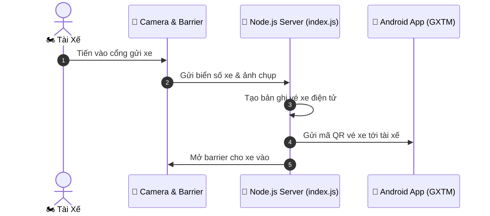

<div align="center">

# 🅿️ SMART PARKING BACKEND SERVER (GXTM V2) 🅿️
### 🚀 Node.js REST API Server for Smart Parking & Barrier Automation
*Máy Chủ Quản Lý Hệ Thống Gửi Xe Thông Minh (GXTM Phiên Bản 2)*

[](https://nodejs.org/)
[](https://expressjs.com/)
[](https://github.com/baolam/srvgxtmverion2)

---

</div>

> [!IMPORTANT]
> **GXTM Version 2 Server** là máy chủ dịch vụ trung tâm quản lý luồng xe ra vào, tính tiền tự động theo biểu phí thời gian và cung cấp API kết nối giữa ứng dụng Android và hệ thống camera nhận diện biển số tại bãi đỗ xe.

---

## 📑 Mục Lục (Table of Contents)
- [✨ Tính Năng Nổi Bật](#-tính-năng-nổi-bật)
- [🏗️ Sơ Đồ Điều Phối Dữ Liệu](#️-sơ-đồ-điều-phối-dữ-liệu)
- [📂 Cấu Trúc Dự Án](#-cấu-trúc-dự-án)
- [⚙️ Công Nghệ Sử Dụng](#️-công-nghệ-sử-dụng)
- [🚀 Hướng Dẫn Cài Đặt & Chạy Server](#-hướng-dẫn-cài-đặt--chạy-server)
- [📜 Giấy Phép (License)](#-giấy-phép-license)

---

## ✨ Tính Năng Nổi Bật

| Biểu Tượng | Tính Năng | Mô Tả Chi Tiết |
| :---: | :--- | :--- |
| 🚪 | **Quản Lý Check-In / Check-Out** | Ghi nhận thời điểm xe vào, kiểm tra đối soát biển số và hình ảnh khi xe ra. |
| 💰 | **Tự Động Tính Phí Gửi Xe** | Áp dụng công thức tính phí dựa theo loại phương tiện (xe máy, ô tô) và thời lượng đỗ. |
| 📊 | **Báo Cáo Trống Chỗ Thời Gian Thực** | Cập nhật số lượng chỗ đỗ còn khả dụng để điều hướng xe mới vào bãi. |
| 📱 | **Phục Vụ API Cho Ứng Dụng Di Động** | Cung cấp endpoints đồng bộ dữ liệu với ứng dụng Android GXTM. |

---

## 🏗️ Sơ Đồ Điều Phối Dữ Liệu



---

## 📂 Cấu Trúc Dự Án

```bash
srvgxtmverion2/
├── 📄 index.js            # Điểm bắt đầu khởi chạy máy chủ Express
├── 📄 package.json        # Danh mục thư viện phụ thuộc Node.js
├── 📂 src/                # Module định tuyến routes, controllers và models
└── 📄 README.md           # Hướng dẫn chi tiết dự án
```

---

## ⚙️ Công Nghệ Sử Dụng

- **Backend Platform**: Node.js, Express.js
- **Network Protocol**: HTTP RESTful API, JSON Payload
- **Database / Storage**: File-based persistence / SQLite

---

## 🚀 Hướng Dẫn Cài Đặt & Chạy Server

```bash
# 1. Clone repository
git clone https://github.com/baolam/srvgxtmverion2.git
cd srvgxtmverion2

# 2. Cài đặt dependencies
npm install

# 3. Khởi chạy server
node index.js
```

---

<div align="center">

## 📜 Giấy Phép (License)

Dự án được phân phối dưới giấy phép **MIT License**.

---
**Made with ❤️ by [Bảo Lâm](https://github.com/baolam)**

</div>
